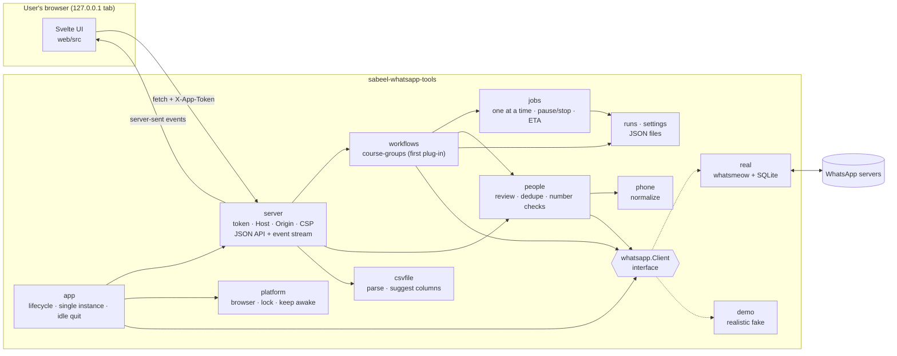
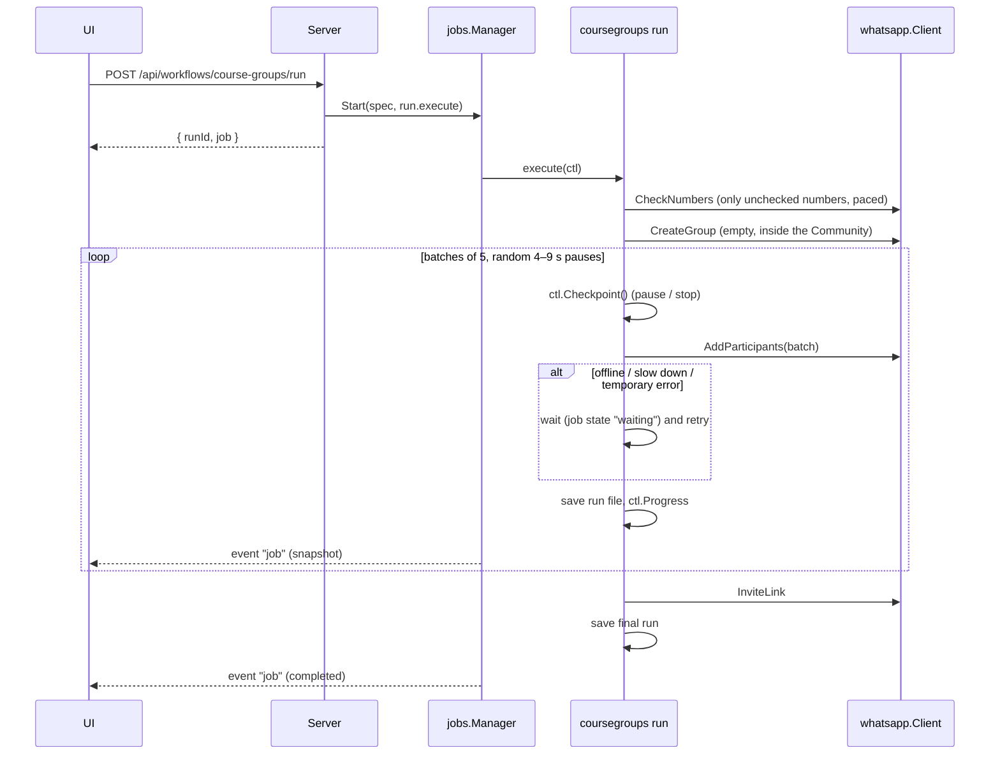
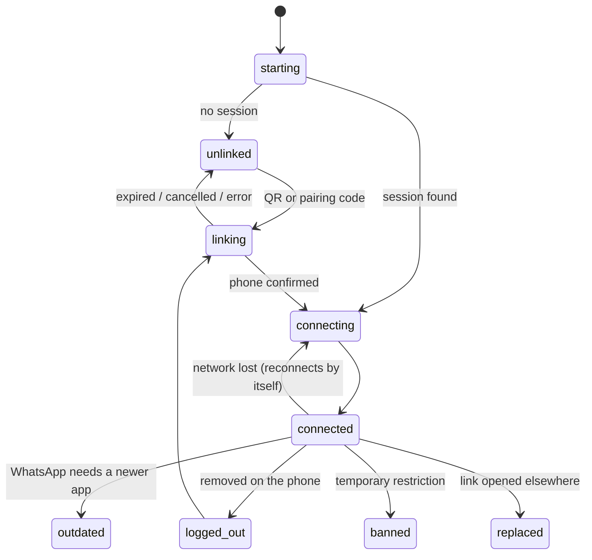

# Developing Sabeel WhatsApp Tools

One Go binary per OS. It embeds a Svelte web UI, serves it on `127.0.0.1` behind a per-launch token, and opens the
user's browser. WhatsApp is reached through [whatsmeow](https://github.com/tulir/whatsmeow), acting as a linked device.
Everything is pure Go (`CGO_ENABLED=0`), so every platform cross-compiles from Linux.

## Architecture



### Repository layout

| Path | What it is |
| --- | --- |
| `cmd/sabeel-whatsapp-tools` | `main`: flags, self-test, the Windows message box for fatal errors |
| `internal/app` | wiring and the desktop lifecycle (single instance, browser, idle shutdown, Quit) |
| `internal/platform` | OS-specific pieces behind build tags: `browser_*.go`, `lock_*.go`, `awake_*.go` |
| `internal/server` | HTTP server, security checks (`security.go`), routes, server-sent events |
| `internal/api` | JSON helpers and user-facing error messages shared by the server and workflows |
| `internal/whatsapp` | the `Client` interface, shared types, error kinds, **pacing** |
| `internal/whatsapp/real` | whatsmeow implementation |
| `internal/whatsapp/demo` | demo implementation (deterministic outcomes, `Simulate`) |
| `internal/csvfile` | spreadsheet parsing and column suggestions |
| `internal/phone` | phone normalization (libphonenumber port) |
| `internal/people` | review statuses, de-duplication, the WhatsApp number checker, `Call` (retry/wait policy) |
| `internal/jobs` | background job runner |
| `internal/runs`, `internal/settings` | persisted history and preferences |
| `internal/workflows` | the workflow plug-in interface |
| `internal/workflows/coursegroups` | the Course groups workflow |
| `internal/webui` | `go:embed` of the built UI (`dist/` is generated) |
| `web/` | Svelte 5 + Vite + TypeScript UI |
| `e2e/` | Playwright suite that drives the real binary in demo mode |
| `testdata/` | sample registration exports |
| `packaging/`, `scripts/`, `assets/icon/` | per-OS packaging, build helpers, generated icons |

### A course-group run



### Connection states



The UI shows the Connect screen for `unlinked`, `linking` and `logged_out`, and a full-page explanation for
`outdated`, `banned` and `replaced`.

### Security model

The server binds only to `127.0.0.1`, on a random port. The app opens `http://127.0.0.1:<port>/#token=<random>`. The
token is in the fragment, so it never reaches the server's logs or Referer headers. The page keeps it in
`sessionStorage` and sends it as `X-App-Token` on every API call and on the event stream. `internal/server/security.go`
rejects:

- a Host header other than `127.0.0.1:<port>` or `localhost:<port>` (DNS rebinding);
- cross-site requests (`Origin`, `Sec-Fetch-Site`);
- `/api/*` requests without the token.

The HTML is served with a CSP that only allows the app's own files, so the UI can't reach the internet even by accident.
The e2e suite fails on any request that leaves `127.0.0.1`.

## Getting started

Requirements: Go (the `go.mod` toolchain line is honoured; Go 1.21+ downloads it automatically), Node 24, `make`,
`shellcheck`, `zip`. For icons: [uv](https://docs.astral.sh/uv/). For the e2e suite: Playwright's Chromium (installed by
`make e2e-deps`).

```sh
make check        # gofmt'd? go vet, go test, shellcheck, svelte-check, prettier
make demo         # build and run in demo mode, logging to the terminal
make run          # build and run against real WhatsApp
make e2e          # drive the whole app in headless Chromium (demo mode)
make screenshots  # the same, saving every screen to docs/screenshots/
```

### UI development with hot reload

Run the Go server on a fixed port with a fixed token and let Vite proxy `/api` to it:

```sh
go run ./cmd/sabeel-whatsapp-tools --demo --no-browser --port 8765 \
  --dev-origin http://localhost:5173 --dev-token devtoken123 --verbose
cd web && npm run dev
# open http://localhost:5173/#token=devtoken123
```

`--dev-origin` allows the Vite origin through the cross-origin check; `--dev-token` fixes the token. Neither belongs in
user-facing instructions.

Useful flags: `--data-dir <dir>` (use a throwaway data folder), `--demo-latency <0.1–10>` (speed up or slow down the demo),
`--self-test` (start, check the page and API respond, quit).

The demo client can be pushed into hard-to-reach states:

```sh
curl -X POST -H 'X-App-Token: devtoken123' -d '{"what":"offline"}' http://127.0.0.1:8765/api/demo/simulate
# what: offline (20 s network drop) | logout | ban | outdated
```

## Building for each OS

```sh
make dist-linux     # dist/linux/ (binary, .desktop, icons, install.sh) + linux-amd64/arm64 .tar.gz
make dist-windows   # dist/windows/SabeelWhatsAppTools.exe (+ .zip); icon/manifest/version via go-winres
make dist-macos     # dist/macos/Sabeel WhatsApp Tools.app (universal) + .zip
make dist           # all of the above
```

- **Windows** builds use `-H=windowsgui` (no console). Resources come from `packaging/windows/winres.json` and
  `assets/icon/`; the `.syso` files are generated during the build and deleted afterwards.
- **macOS**: on a Mac, `lipo` makes the universal binary and `scripts/package-macos.sh` signs the bundle ad hoc. On Linux,
  `makefat` makes it and the bundle is unsigned (the Go linker already ad-hoc signs the arm64 slice). For a Developer ID
  signature and notarization, see the comment at the top of `scripts/package-macos.sh`.
- **Version**: `git describe --tags`, overridable with `make dist VERSION=1.2.3`.

### CI and releases

`.github/workflows/build.yml` runs on every push to `main` and every pull request:

1. lint and unit tests (`make check`);
2. the Playwright suite in demo mode;
3. Linux and Windows packages, built on Ubuntu;
4. the macOS universal app, built on a macOS runner (lipo, ad-hoc signature);
5. `--self-test` of each package on its own OS (Linux, Windows, macOS on Apple silicon, Intel through Rosetta when
   available).

To publish a release, tag a commit: `git tag v0.2.0 && git push origin v0.2.0`. The workflow attaches the Linux, Windows
and macOS packages to a GitHub release.

### Icons

`assets/icon/` and `web/public/{favicon,logo,mark}.png` are generated from the Sabeel brand repository and committed:

```sh
uv run scripts/make-icons.py --brand ../brand   # or: make icons
```

## Adding a workflow

1. **Backend:** create `internal/workflows/<name>/` implementing `workflows.Workflow`:
   - `Info()` gives the title, description and the actions shown on the home screen (`icon` is a Lucide name the UI
     maps in `web/src/workflows/registry.ts`);
   - `Routes(r)` registers endpoints, mounted under `/api/workflows/<id>/`.

   Use `deps.Jobs.Start` for anything long, `people.Call` around every WhatsApp request (it handles offline, slow-down
   and temporary errors), `deps.Pacing` for delays, and `deps.Runs` to save a `runs.Run` with your own `Detail`.
2. Add it to the list in `internal/app/app.go`.
3. **Frontend:** add `web/src/workflows/<id>/` with a wizard component (`{ action }` prop) and a result component (`{ run }`
   prop), and register both in `web/src/workflows/registry.ts`. Reuse `people/ImportStep`, `MatchStep` and `ReviewStep`
   with a `PeopleList` if the workflow starts from a spreadsheet.
4. If it needs a new WhatsApp operation, add it to `whatsapp.Client` and implement it in both `real` and `demo`.
5. Extend the e2e suite.

## Updating whatsmeow

WhatsApp changes its protocol from time to time, and whatsmeow follows within days. When users see **"Please update the
app"** (whatsmeow's `ClientOutdated`, after the app's automatic version refresh), or linking or adding starts failing:

```sh
go get go.mau.fi/whatsmeow@latest
go mod tidy
go build ./... && go test ./...
```

whatsmeow has no tagged releases and changes its API without notice. Re-read the source of everything
`internal/whatsapp/real` uses and fix the compile errors:

- `CreateGroup` / `ReqCreateGroup` (`GroupLinkedParent`, `GroupAnnounce`, `GroupLocked`, `GroupMembershipApprovalMode`);
- `UpdateGroupParticipants` and `types.GroupParticipant` (`Error`, `AddRequest`);
- `GetJoinedGroups` and `types.GroupInfo` (`IsParent`, `LinkedParentJID`, `IsDefaultSubGroup`, participants' `IsAdmin`);
- `IsOnWhatsApp`, `GetGroupInviteLink`, `SetGroupTopic`, `SendMessage` with `waE2E.GroupInviteMessage`;
- `GetQRChannel` events (`QRChannel*`, including passkey events) and `PairPhone`;
- `sqlstore.New` and the dialect name (`"sqlite"` for `modernc.org/sqlite`);
- error values in `errors.go` (mapped in `real/errors.go`; covered by `real/errors_test.go`).

Then link a test account with `make run`, create a test group with two numbers, and tag a release. Bump
`modernc.org/sqlite` and `github.com/nyaruka/phonenumbers` (country metadata) at the same time.

## Tuning the pacing

All delays and batch sizes live in `internal/whatsapp/pacing.go` (`DefaultPacing`). Keep them conservative: WhatsApp
restricts accounts that add or message many people who haven't saved their number. The UI's time estimates read the same
values from `/api/app`.

## Data and logs

The app's data lives in `os.UserConfigDir()/sabeel-whatsapp-tools` (`demo/` inside it for demo mode): `session.db`
(whatsmeow; 0600), `settings.json`, `runs/*.json`, `logs/app.log` (5 MB × 4, phone numbers redacted by
`internal/logging`), and `instance.lock`/`instance.json` for single-instance handling.
