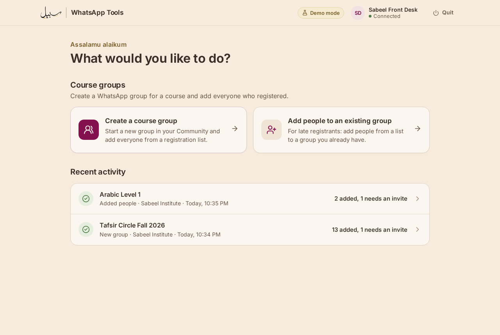
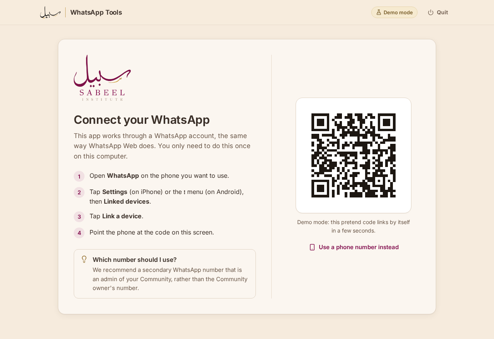
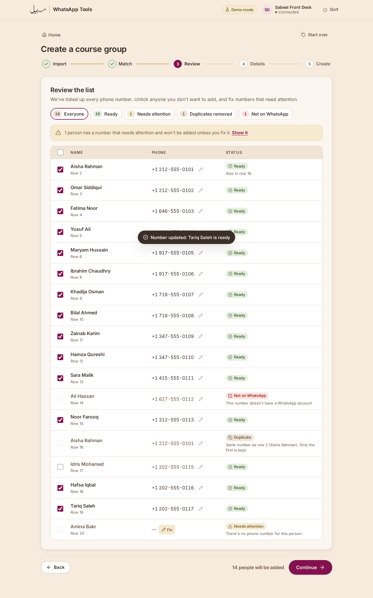
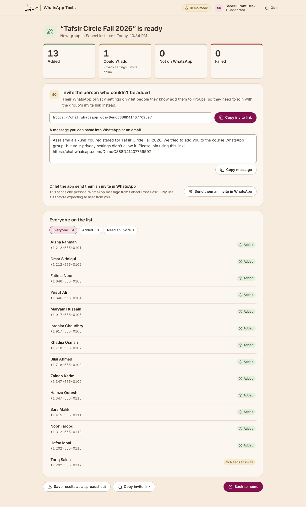

# Sabeel WhatsApp Tools

A small desktop app for Sabeel Institute staff that does WhatsApp chores for you. Its first job is **course groups**: take
the spreadsheet of people who registered for a course, create a WhatsApp group for the course inside your WhatsApp
Community, and add everyone, without typing a single number by hand.

What it does for a course:

1. Connects to your WhatsApp the same way WhatsApp Web does (you scan a code once).
2. Reads the registration spreadsheet file (.csv) from your sign-up or payment system, whatever its columns are called.
3. Tidies up every phone number, spots mistakes and duplicates, and checks who has WhatsApp.
4. Creates the group in your Community (or uses an existing one) and adds people a few at a time, the way a careful
   person would.
5. Shows who was added, who couldn't be, and gives you the group's invite link and a ready-made message for anyone whose
   privacy settings didn't allow adding them.

Everything happens on your computer. The app talks only to WhatsApp, and nothing is sent anywhere else.

## Before you start

- You need a WhatsApp account that is an **admin of your Community**. We recommend a secondary number (for example the
  institute's front-desk phone) rather than the Community owner's own number.
- Ask registrants to save that number in their phone contacts. People who haven't saved it may have privacy settings
  that stop the app from adding them; the app gives you an invite link for them instead.

## Install and open the app

Download the file for your computer from the project's
[Releases page](https://github.com/Sabeel-Institute/WhatsApp-Tools/releases).

### Linux

1. Download `sabeel-whatsapp-tools-<version>-linux-amd64.tar.gz` and open it (double-click), then extract it.
2. In the extracted folder, run `install.sh` (right-click it → **Run as a Program**, or open a terminal there and type
   `./install.sh`).
3. Open **Sabeel WhatsApp Tools** from your apps menu. It opens in your web browser.

To remove it later, run `uninstall.sh` from the same folder.

### Windows

The Windows version is built but not yet tested on a real Windows computer. It passes an automatic start-up check on
Windows.

1. Download `sabeel-whatsapp-tools-<version>-windows-amd64.zip`, right-click it and choose **Extract All**.
2. Double-click **SabeelWhatsAppTools.exe**.
3. The first time, Windows may say **"Windows protected your PC"**. Click **More info**, then **Run anyway**. (This
   appears because the app isn't signed with a paid certificate yet.)
4. The app opens in your web browser. You can drag the .exe to your desktop or pin it to the taskbar.

### macOS

The Mac version is built but not yet tested on a real Mac. It passes an automatic start-up check on macOS. It works on
both Apple silicon and Intel Macs, with macOS 12 or newer.

1. Download `sabeel-whatsapp-tools-<version>-macos-universal.zip` and double-click it to unzip.
2. Drag **Sabeel WhatsApp Tools** into your **Applications** folder.
3. The first time, **right-click** (or Control-click) the app and choose **Open**, then **Open** again. On macOS 15
   (Sequoia) or newer, if that isn't offered: try to open it once, then go to **System Settings → Privacy & Security**,
   scroll down and click **Open Anyway**. You only need to do this once.
4. The app opens in your web browser. It has no Dock icon; use the **Quit** button in the app to close it.

## Try it safely first: demo mode

Demo mode is a pretend WhatsApp account with pretend Communities. Nothing is sent to WhatsApp, so you can try every step
safely. It shows a **Demo mode** badge at the top.

- **Linux:** right-click **Sabeel WhatsApp Tools** in your apps menu and choose **Try it in demo mode**. (Or in a
  terminal: `sabeel-whatsapp-tools --demo`.)
- **Windows:** right-click **SabeelWhatsAppTools.exe** → **Create shortcut**. Right-click the shortcut →
  **Properties**, and at the end of **Target** add a space and `--demo`. Open the app with that shortcut.
- **macOS:** open **Terminal** and type `open -a "Sabeel WhatsApp Tools" --args --demo`.

In demo mode the QR code links by itself after a few seconds. Demo mode keeps its own history, separate from the real one.

## Connect WhatsApp

The first time you open the app it shows a QR code.

1. On the phone with the WhatsApp account you'll use, open **WhatsApp**.
2. Tap **Settings** (iPhone) or the **⋮** menu (Android), then **Linked devices**, then **Link a device**.
3. Point the phone at the code on the screen.

If scanning is awkward, choose **Use a phone number instead**: type the account's number, and the app shows an 8-letter
code to type on the phone (**Link a device → Link with phone number instead**).

You only do this once. Afterwards the app shows the connected account at the top right. To unlink this computer, click
the account and choose **Disconnect WhatsApp**.

## Create a course group

On the home screen, choose **Create a course group**, then follow the five steps.

1. **Import.** Export the list of registrants from your sign-up or payment system as a spreadsheet file (.csv) and drag
   it onto the page (or click **Choose file**). Excel users: **File → Save As → CSV UTF-8**.
2. **Match.** The app guesses which column has the phone number and which has the names, and marks its guesses
   **Suggested**. Check them; change any that are wrong. Choose the country for numbers written without a country code
   (United States is the default). Next time you import a file with the same columns, your choices are remembered.
3. **Review.** Every number is tidied up and checked with WhatsApp. Use the coloured buttons at the top to see who is
   **Ready**, what was **Fixed automatically**, who **Needs attention**, which **Duplicates** were removed, and who is
   **Not on WhatsApp**. Click **Fix** next to a number to correct it; untick anyone you don't want to add.

   

4. **Details.** Choose the Community, type the group's name (25 characters at most) and, if you like, a description.
   **More options** has the group settings: only admins can send messages (off), only admins can edit group info (on),
   new members need approval to join by link (on).
5. **Create.** Check the summary and click **Create group and add …**.

The app then adds people **5 at a time with short pauses**, to keep the WhatsApp account safe. You see who has been added
as it happens, and roughly how long is left. You can **Pause** or **Stop** at any time; everyone already added stays in
the group. If the internet drops, the app waits and carries on by itself.

### When it finishes

The results show how many people were **Added**, how many **Couldn't add** because of their privacy settings, who is
**Not on WhatsApp**, and anyone who **Failed**.

For people who couldn't be added:

- **Copy invite link** copies the group's link, and **Copy message** copies a friendly ready-to-send message with the
  link. Paste it into WhatsApp, an email or a text.
- Or click **Send them an invite in WhatsApp**: the app sends each of them a personal WhatsApp message from the connected
  account, one at a time. Only do this if they expect to hear from you.

**Save results as a spreadsheet** saves a file with everyone's name, number and result. Every run is listed under
**Recent activity** on the home screen, where you can open it again later.

## Add late registrants to an existing group

Choose **Add people to an existing group** on the home screen. The steps are the same, except that in step 4 you choose
the Community and then the group. Only groups where the connected account is an admin can be chosen.

## Closing the app

Click **Quit** at the top right. (While the app is adding people, it asks you to wait or stop first.) If you just close
the browser tab, the app quits by itself after about 15 minutes. It never quits in the middle of adding people.

## If something goes wrong

| What you see | What to do |
| --- | --- |
| "That file didn't work" | Save the list as **CSV** (not .xlsx) and try again. |
| "This number was damaged by Excel" | Excel turned the number into something like 1.21E+10. Fix the number in your original file, or click **Fix** and type it in. |
| "This account can't create groups in any Community" | Ask a Community admin to make the connected number an admin of the Community, then click **Refresh**. |
| "WhatsApp disconnected this computer" | Scan the new QR code to link it again. |
| "Please update the app" | WhatsApp changed something; get the newest version from the Releases page. |
| "WhatsApp has paused this account" | WhatsApp has temporarily restricted the account. Wait, then add people in smaller groups. |
| The page says "The app isn't running" | Open the app again from your apps menu. |

## Where your data is kept, and how to reset

The app keeps its data in a private folder for your user account:

| Computer | Folder |
| --- | --- |
| Linux | `~/.config/sabeel-whatsapp-tools` |
| Windows | `%AppData%\sabeel-whatsapp-tools` (usually `C:\Users\<you>\AppData\Roaming\sabeel-whatsapp-tools`) |
| macOS | `~/Library/Application Support/sabeel-whatsapp-tools` |

Inside it:

- `session.db`: the WhatsApp link. **Treat it like a password**: anyone with this file could use the linked account.
- `settings.json`: your default country and remembered column choices.
- `runs/`: the history shown under Recent activity, including names and numbers from your lists.
- `logs/`: technical logs for troubleshooting. Phone numbers are removed from them.
- `demo/`: the same files for demo mode.

**To start completely fresh:** in the app, click the account at the top right and choose **Disconnect WhatsApp**, then
**Quit**, then delete the folder above. (Deleting the folder without disconnecting first leaves "Sabeel WhatsApp Tools"
listed under Linked devices on the phone; remove it there.)

## For developers

See [DEVELOPING.md](DEVELOPING.md) for how the app is built, and [DECISIONS.md](DECISIONS.md) for why it works the way it
does.
